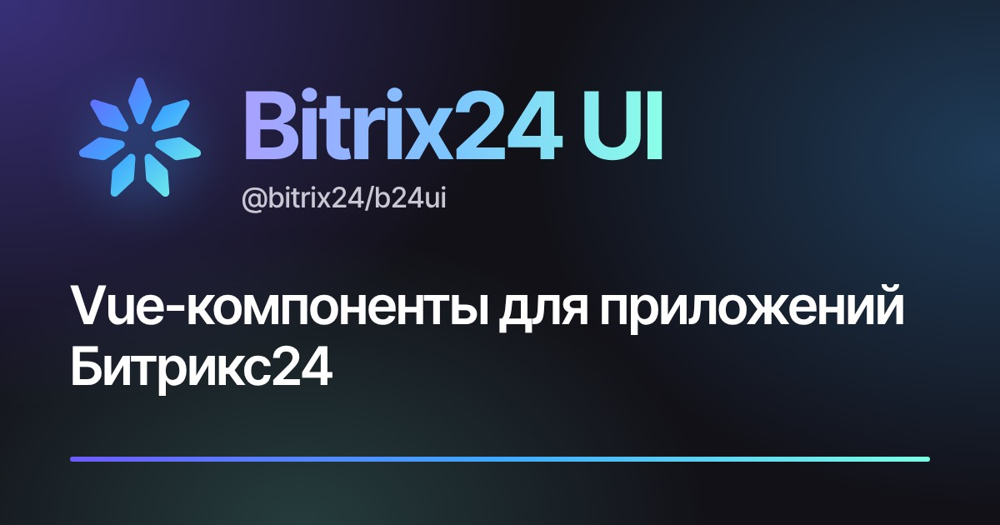

<p align="center">
  <a href="https://b24-ui.bx-shef.by/"></a>
</p>

<p align="center">
  <a href="https://b24-ui.bx-shef.by/"></a>
  <a href="https://github.com/bx-shef/b24-ui/releases"></a>
  <a href="https://github.com/bx-shef/b24-ui/blob/main/LICENSE"></a>
</p>

# Bitrix24 UI — `@bxshefby/b24ui-nuxt`

Библиотека интерфейса Битрикс24 для Nuxt и Vue: компоненты в стиле портала для приложений на REST API.
Репозиторий — русскоязычный форк [bitrix24/b24ui](https://github.com/bitrix24/b24ui), который регулярно
синхронизируется с [nuxt/ui](https://github.com/nuxt/ui).

**Сайт и документация:** <https://b24-ui.bx-shef.by/>

## Что умеет

* **Компоненты Битрикс24.** Кнопки, формы, таблицы, меню, диалоги и другие элементы в оформлении портала, с темами и тёмным режимом.
* **Nuxt и Vue.** Модуль для Nuxt и плагин для Vite с Vue; Tailwind CSS и иконки Битрикс24 подключаются из коробки.
* **Документация по-русски.** Каждый компонент — с примерами, параметрами и темой оформления.
* **Для AI-агентов.** Страницы документации отдаются в `llms.txt`, а MCP-сервер сайта даёт агенту поиск по компонентам.
* **Синхронизация с nuxt/ui.** Новые возможности апстрима переносятся по одному изменению, с проверкой.

## Документация и AI

| Что | Где |
|---|---|
| Документация и примеры | <https://b24-ui.bx-shef.by/> |
| «Спросить AI» — чат по документации | кнопка в шапке сайта, горячая клавиша `Ctrl/Cmd + I` |
| Файлы для AI-инструментов | [`/llms.txt`](https://b24-ui.bx-shef.by/llms.txt) и [`/llms-full.txt`](https://b24-ui.bx-shef.by/llms-full.txt) |
| MCP-сервер документации | <https://b24-ui.bx-shef.by/mcp> |
| Навыки для агентов | [`skills/`](skills) |
| Правила для AI-ассистентов в репозитории | [`AGENTS.md`](AGENTS.md) |

## Установка

Нужны Vue 3.5+ и Tailwind CSS 4.

```bash
pnpm add @bxshefby/b24ui-nuxt @bitrix24/b24icons-vue tailwindcss
```

```bash
yarn add @bxshefby/b24ui-nuxt @bitrix24/b24icons-vue tailwindcss
```

```bash
npm install @bxshefby/b24ui-nuxt @bitrix24/b24icons-vue tailwindcss
```

```bash
bun add @bxshefby/b24ui-nuxt @bitrix24/b24icons-vue tailwindcss
```

Приложение уже стоит на пакете родительского проекта? Переход — [Имя пакета](https://b24-ui.bx-shef.by/docs/getting-started/package/).

### Nuxt

1. Добавьте модуль в `nuxt.config.ts`:

```ts
export default defineNuxtConfig({
  modules: ['@bxshefby/b24ui-nuxt'],
  css: ['~/assets/css/main.css']
})
```

2. Подключите Tailwind CSS и Bitrix24 UI в `app/assets/css/main.css`:

```css
@import "tailwindcss";
@import "@bxshefby/b24ui-nuxt";
```

Подробнее — [установка в Nuxt](https://b24-ui.bx-shef.by/docs/getting-started/installation/nuxt/).

### Vue

1. Добавьте Vite-плагин в `vite.config.ts`:

```ts
import { defineConfig } from 'vite'
import vue from '@vitejs/plugin-vue'
import bitrix24UIPluginVite from '@bxshefby/b24ui-nuxt/vite'

export default defineConfig({
  plugins: [
    vue(),
    bitrix24UIPluginVite()
  ]
})
```

2. Подключите Vue-плагин в `src/main.ts`:

```ts
import './assets/css/main.css'

import { createApp } from 'vue'
import { createRouter, createWebHistory } from 'vue-router'
import b24UiPlugin from '@bxshefby/b24ui-nuxt/vue-plugin'
import App from './App.vue'

const app = createApp(App)

const router = createRouter({
  routes: [],
  history: createWebHistory()
})

app.use(router)
app.use(b24UiPlugin)

app.mount('#app')
```

3. Подключите Tailwind CSS и Bitrix24 UI в `src/assets/css/main.css`:

```css
@import "tailwindcss";
@import "@bxshefby/b24ui-nuxt";
```

Подробнее — [установка в Vue](https://b24-ui.bx-shef.by/docs/getting-started/installation/vue/).

## Нужна разработка

Приложение на Bitrix24 UI, доработка компонентов или тема под ваш проект — оставьте
[запрос на разработку](https://cowork.bx-shef.by/?type=dev&product=b24-ui#start).

## Участие в разработке

Вот несколько способов принять участие:

- **Безопасность.** Нашли уязвимость? [Сообщите о ней приватно](https://github.com/bx-shef/b24-ui/security/advisories/new), а не через формы ниже. Что считается уязвимостью, сказано в [SECURITY.md](SECURITY.md).
- **Ошибки.** [Создайте отчёт об ошибке](https://github.com/bx-shef/b24-ui/issues/new?template=bug-report.yml). В форме просят воспроизведение — от этого поля зависит, можно ли что-то сделать по отчёту; см. [как сообщить об ошибке](CONTRIBUTING.md#reporting-a-bug).
- **Предложения.** [Создайте запрос на новую возможность](https://github.com/bx-shef/b24-ui/issues/new?template=feature-request.yml).
- **Код.** [CONTRIBUTING.md](CONTRIBUTING.md) — настройка окружения, подробные руководства и то, чего CI ждёт от pull request. Как запустить репозиторий — в [руководстве по участию](https://b24-ui.bx-shef.by/docs/getting-started/contribution/).
- **README.** Правила оформления — [.github/contributing/readme.md](.github/contributing/readme.md).

> [!TIP]
> Правила для AI-ассистентов лежат в [`AGENTS.md`](AGENTS.md): файл подхватывают AI-агенты для программирования, он подсказывает устройство компонентов, темизацию, тесты и правила документации.

## Лицензия

[MIT](LICENSE). Исходный проект — [bitrix24/b24ui](https://github.com/bitrix24/b24ui).

## Благодарности

- [nuxt/nuxt](https://github.com/nuxt/nuxt)
- [nuxt/ui](https://github.com/nuxt/ui)
- [unovue/reka-ui](https://github.com/unovue/reka-ui)
- [tailwindlabs/tailwindcss](https://github.com/tailwindlabs/tailwindcss)
- [vueuse/vueuse](https://github.com/vueuse/vueuse)

---

## Другие проекты семейства

| Проект | Что делает |
|---|---|
| [b24-js-sdk](https://b24-js-sdk.bx-shef.by) | JS SDK для REST API Битрикс24 |
| [b24-icons](https://b24-icons.bx-shef.by) | иконки Битрикс24 для Vue и Nuxt |
| [shef.cowork](https://cowork.bx-shef.by/) | AI-агент для вашего Битрикс24 |
